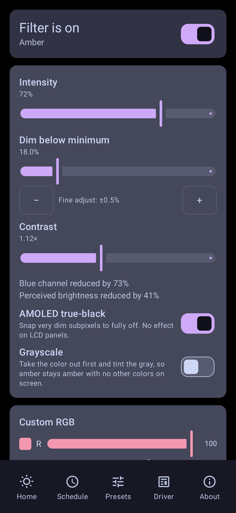
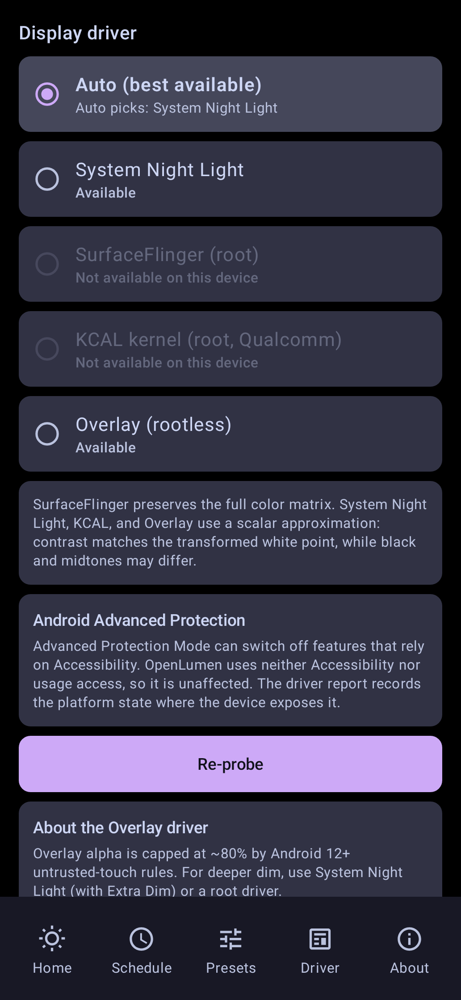
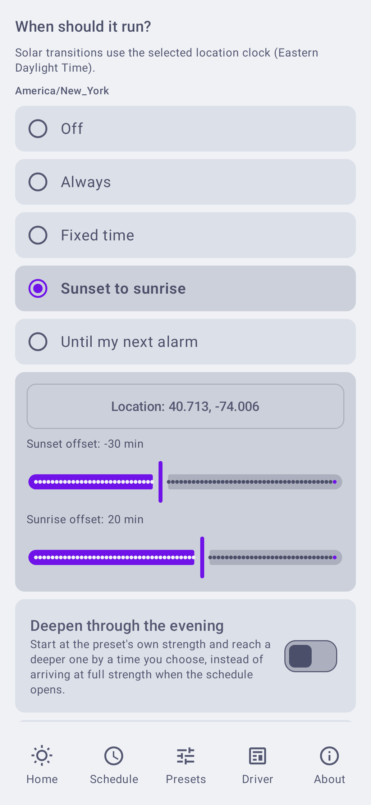

# OpenLumen

[](https://github.com/SysAdminDoc/OpenLumen/releases) [](LICENSE) [](#requirements) [](app/build.gradle.kts) [](#privacy)

<p align="center">
  <a href="https://ko-fi.com/X8K126YVER">
    
  </a>
</p>

<p align="center">
  <sub><em>If OpenLumen makes your display easier to use, a coffee helps me keep its device paths tested and maintained.</em></sub>
</p>

> **OpenLumen changes the display itself instead of painting a layer over it.** Three of its four drivers work below the app layer. Two write the colour transform the compositor already applies, and one drives the panel through the kernel. The tint reaches the status bar, the notification shade and the lock screen, and it never swallows a tap. The overlay driver is only a fallback for devices where nothing else is reachable.

If you came here after CF.Lumen, that's probably the sentence you were looking for. Most of what replaced it paints a coloured window over your screen, and you can tell. The tint stops at the edges of the app, taps land in the wrong place during installs, and every screenshot comes out orange.

People mostly use it for two things.

**Fixing a screen that is the wrong colour.** Some panels ship with a cast, usually a green one that reads as a yellow tint on white. Per-channel RGB and gamma let you pull it back, and the settings persist across reboots, so you calibrate once instead of turning a mode on every night.

**Evening colour shift.** This is the usual one. Warm the screen on a schedule, by clock time, by sunrise and sunset for your location, or until your next alarm.

Some people also want something no Android app really handles, which is holding the panel's hardware brightness high while dimming in software instead of letting the backlight drop. Every driver here dims in software, and the root drivers and the system's Extra Dim can go below the panel's own minimum. Whether that suits you is yours to judge. [docs/health-evidence.md](docs/health-evidence.md) covers what is and isn't established.

CF.Lumen has been dormant since December 2020. Red Moon, the main open-source overlay-only competitor, has been unmaintained since August 2022. OpenLumen exists to fill that gap on Android 14 / 15. It has a Compose UI and four display drivers you can switch at runtime, and it sends no telemetry.

| Home | Driver | Schedule |
| --- | --- | --- |
|  |  |  |

---

## Why OpenLumen?

- Three of four drivers work below the app layer, so the tint covers the whole screen, passes touches through and leaves screenshots untinted.
- Per-channel RGB and gamma, so you can correct a panel's colour cast as well as warm it.
- No INTERNET permission, ever. The app is fully offline and F-Droid clean.
- A Catppuccin Mocha and AMOLED true-black Compose UI, dark by default.
- A Quick Settings tile for one-tap toggling, which CF.Lumen never shipped.
- Licensed GPL-3.0-or-later, which keeps it in Red Moon's lineage.
- Current Android targets, with minSdk 26 and targetSdk 35 (Android 15).
- Built with Kotlin, Jetpack Compose, Material 3, Hilt, DataStore and kotlinx.serialization.

## Display drivers

OpenLumen ships four `ColorEngine` implementations and probes each at first launch:

| Driver | Root? | SoC | Quality | Notes |
|--------|------|-----|---------|-------|
| `SecureSettings` | No¹ | Any | Framebuffer | Drives system Night Light and Extra Dim through `Settings.Secure`. API 29+. Samsung phones have no Night Light, so it can't tint there. |
| `SurfaceFlinger` | Yes | Any | Framebuffer | `service call SurfaceFlinger` color-transform. Works on Tensor/Exynos/MediaTek too. |
| `KCAL` | Yes | Qualcomm | Panel driver | Requires custom kernel exposing `/sys/devices/platform/kcal_ctrl.0/kcal*`. |
| `Overlay` | No | Any | Compositor blend | Universal fallback. Capped at ~80% opacity by Android 12+ rules. |

Overlay and SecureSettings have been checked on two Samsung phones, a Galaxy S22 on Android 16 and an S25 Ultra on Android 17. Neither ships Night Light, so Auto picks Overlay on both. The two root drivers haven't been confirmed on hardware yet. [docs/device-matrix.md](docs/device-matrix.md) has the results, and if you run one, the Driver tab's Share report produces exactly what that file wants.

¹ You need to grant `WRITE_SECURE_SETTINGS` once, with `adb shell pm grant com.openlumen android.permission.WRITE_SECURE_SETTINGS`. No computer? If [Shizuku](https://github.com/RikkaApps/Shizuku) is running, tap Grant with Shizuku on the Driver tab instead.

The secure-settings driver writes the same rows `ColorDisplayService` watches, so the compositor applies the tint. It covers the status bar, notification shade and lock screen, it doesn't block touches, and screenshots come out untinted. On devices that ship Extra Dim (Android 12+, and not every OEM does) it also dims below the panel's minimum backlight without root, which is the one thing the overlay driver can't do. It carries chromaticity as a colour temperature, though, so per-channel gamma and the colour-vision presets still need a root driver.

Releases through 0.7.1 shipped a `ColorDisplayManager` driver here that couldn't work on any user install. Those APIs need `CONTROL_DISPLAY_COLOR_TRANSFORMS`, which is `signature|privileged` and can't be granted with `pm grant`. If you tried the AOSP driver on an older build and saw nothing happen, that was why.

The app falls back gracefully. Auto prefers the best available root path (`SurfaceFlinger`, then `KCAL`), and non-root devices use Overlay by default. If you want a specific driver such as `SecureSettings`, Settings → Driver lets you pin one. If that pinned driver later probes as unavailable, OpenLumen resets to Auto instead of leaving the filter enabled with no visible effect.

## Features (v0.8.0)

**Color**

- Named presets: Night · Amber · Red · Salmon · Sepia · Grayscale · Deep Sleep · PWM Comfort · Protan · Deutan · Tritan
- Software dimming on every driver, and below the panel minimum on the root drivers and the system Extra Dim, for holding hardware brightness high and darkening in software instead ([what is and is not established](docs/health-evidence.md))
- Custom R/G/B picker on Home with live color preview
- Kelvin color-temperature slider (1000 to 10 000 K) with Tanner Helland conversion
- Per-channel gamma sliders (γR / γG / γB, range 0.5 to 2.5)
- Intensity slider (0 to 100% lerp toward identity) and dim slider (0 to 95%)
- Contrast multiplier (0.5 to 2.0×)
- AMOLED true-black clamp (opt-in, snaps very dim subpixels to fully off)
- Grayscale under any preset, so a tint stays on a gray screen (SurfaceFlinger and System Night Light drivers)
- Blue-channel reduction indicator (a physical measurement, not a sleep claim)

**Scheduling**

- Solar-position schedule (NOAA algorithm, hand-rolled, no external library)
- Sunset / sunrise offset sliders (±180 minutes)
- Fixed-time schedule with Material 3 24-hour time pickers
- Exact-alarm warning with a settings action when Android downgrades timed transitions to inexact alarms
- "Until my next alarm" mode driven by the system alarm clock
- Location from a bundled offline city picker (~95 cities, no Play Services), typed coordinates, or an optional "Use my location" button
- "Use my location" asks for approximate (coarse) location only while the app is open. It never asks for precise or background location, and the reading never leaves the phone
- Optional automatic location for the solar schedule. It refreshes when you open the app after you've moved 15 miles or more, and you get a notification if you change time zones in between
- Ambient-light-sensor trigger (lux below the threshold engages the filter, and either that or the schedule can turn it on)
- Live lux readout + "calibrate: use current reading" button
- Smooth fade-in / fade-out transitions (Instant / 30 s / 1 min / 3 min / 5 min / 15 min / 30 min), or a custom length of any whole number of minutes up to 30
- Optional progressive intensity: start at the preset's strength and reach a deeper one by a time you set, stepped by the schedule's own alarm
- Optional day filter for the hours outside the schedule, with its own colour temperature (2500 to 6500 K) and dim. The screen fades to your preset when the window opens and back when it closes
- Schedule timezone hint so fixed-time windows are unambiguous after travel

**Command surfaces**

- Quick Settings tile (the subtitle shows the active preset, and a long press opens the app)
- Grayscale tile and four preset tiles that follow your favorites
- 1 × 1 toggle widget
- 4 × 1 favorites widget (tap a chip to switch presets)
- Foreground-service notification with Turn-off and Next-preset actions
- Token-authenticated Tasker / Termux / ADB intent surface, off by default (`docs/automation.md`)

**Persistence + reliability**

- Foreground service with `specialUse` type (Android 14+ compliant)
- AlarmManager-driven schedule transitions (`setExactAndAllowWhileIdle`, Doze-resilient)
- Boot persistence with crash-window safety net (no auto-restart after a recent crash)
- Profile export / import as JSON via Storage Access Framework, with diff preview
- Named profile library: save current configuration, load it back later
- Portable preset packs with merge preview, custom built-in labels, and alphabetical or recent ordering
- Previous-preset restore (one-tap undo of a preset change)
- Local-only crash log + structured diagnostics log (`filesDir/`, viewable in-app)
- Diagnostics timeline range and text search over the active log filters
- Versioned preference schema with explicit migrations

**Trust + privacy**

- No INTERNET permission, ever (local release checks reject builds that contain one)
- No Play Services / Firebase / Google APIs (local release checks reject builds that pull them in)
- Cloud backup includes solar coordinates only when Android reports client-side encryption. Device transfer and explicit profile export stay available without it
- No accessibility service, no usage-stats permission and no foreground-app detection
- Permission rationale card for SYSTEM_ALERT_WINDOW (overlay driver)
- In-app driver report (Copy or Share) with zero PII. It captures the device, build, granted permissions and every engine's probe result

## Privacy

OpenLumen requests **zero** network permissions. There's no telemetry, crash reporting or remote config. You can verify it with:

```bash
aapt dump permissions OpenLumen-release.apk | grep INTERNET
# (no output)
```

## Requirements

- Android 8.0 (API 26) or higher
- For best results, root with Magisk-managed `su`, or any Android 10+ device with `WRITE_SECURE_SETTINGS` granted over ADB or through Shizuku (the secure-settings driver rides the system's own Night Light transform).

## Build

```bash
git clone https://github.com/SysAdminDoc/OpenLumen.git
cd OpenLumen
export JAVA_HOME="/c/Program Files/Eclipse Adoptium/jdk-21.0.12.8-hotspot"
./gradlew assembleRelease
# Fails unless release signing env vars are present.
```

Signed release builds require:

```bash
export OPENLUMEN_KEYSTORE=/path/to/release.jks
export OPENLUMEN_KEYSTORE_PASSWORD=...
export OPENLUMEN_KEY_ALIAS=openlumen
export OPENLUMEN_KEY_PASSWORD=...
./gradlew assembleRelease
```

Those four variables are the only place the build looks. There is no `keystore.properties`, `signing.properties` or `local.properties` path, and adding one would be ignored.

Unsigned release output is only for local reproducibility or F-Droid rebuild checks:

```bash
./gradlew assembleRelease -Popenlumen.allowUnsignedRelease=true
```

Run the full local release gate before tagging:

```bash
py -3 tools/local_release_gate.py
```

The gate's SPDX SBOM includes a declared/concluded SPDX license and source provenance for every resolved release dependency. A dependency with missing or prohibited metadata fails the gate unless its exact coordinate has a reviewed entry in `tools/sbom-license-overrides.json`.

Review stable version-catalog updates during release planning:

```bash
py -3 tools/dependency_update_review.py
```

Lint user-facing copy for unsupported health claims:

```bash
py -3 tools/health_claim_lint.py
```

For local reproducibility or F-Droid rebuild checks without signing keys:

```bash
py -3 tools/local_release_gate.py --allow-unsigned-release
```

The gate writes its outputs to `build/reports/openlumen-release-gate/`. That's the SBOM JSON, the advisory report, the release classpath, SHA-256 sums and the signature status.

The signed/release gate queries OSV and fails on incomplete responses, missing severity metadata or unreviewed High/Critical advisories. An offline advisory scaffold is kept for explicitly unsigned local/F-Droid checks only, run as `py -3 tools/local_release_gate.py --allow-unsigned-release --advisory-mode offline`.

## Module layout

```
OpenLumen/
├── app/            : Compose UI, foreground service, tile, boot receiver
├── core-engine/    : ColorEngine abstraction + 4 driver impls + DriverProbe
├── core-schedule/  : NOAA solar calculator, schedule modes, light sensor adapter
└── core-prefs/     : DataStore-backed prefs, JSON serialization
```

## Documentation

### For users

- [Troubleshooting](docs/troubleshooting.md): common driver and overlay problems, recovery from stuck states
- [Compatibility table](docs/compatibility-table.md): which engines work on which hardware
- [Root mode safety and recovery](docs/root-safety.md): what can go wrong with root drivers, and how to recover
- [Automation](docs/automation.md): Tasker / Termux / ADB intent reference
- [Health and evidence notes](docs/health-evidence.md): what we will and will not claim

### For contributors

- [Architecture overview](docs/ARCHITECTURE.md): modules, runtime flow, engine contract
- [Contributing](CONTRIBUTING.md): style, tests, driver-work expectations
- [Translations and localization](docs/translations.md): how to contribute a translation
- [Device validation matrix](docs/device-matrix.md): per-engine smoke flow, current device coverage
- Driver report matrix helper: `py -3 tools/driver_report_matrix.py report.txt`
- [Profile import lineage formats](docs/profile-import-formats.md): notes for future Red Moon / CF.Lumen importers

### For distributors and packagers

- [Release checklist](docs/release-checklist.md): pre-flight, verification, no-INTERNET assertion
- [Reproducible build notes](docs/reproducible-build.md): environment pinning, verification procedure
- [Play FGS evidence pack](docs/play-fgs-evidence.md): Play `specialUse` justification

### Security and supply chain

- [Threat model](docs/threat-model.md): MASVS-lite categories with mitigations
- [SBOM and advisory scan](docs/sbom-and-advisories.md): local scan and triage policy
- [Dependency verification](docs/dependency-verification.md): Gradle metadata procedure (opt-in)
- [Wake / alarm / battery audit](docs/wake-and-vitals.md): what wakes the device and why

### Roadmap and design

- [Overlay safety and per-app design notes](docs/overlay-and-per-app-design.md): why per-app behavior is deferred until the trust posture is sorted
- [Deferred roadmap candidates](docs/deferred-candidates.md): design sketches for Wear OS / Android TV / etc.
- [Android 17 readiness](docs/android-17-readiness.md): forward-looking Android-version migration notes (renamed from `api-36-readiness.md` in rev 4)
- [Research watchlist](docs/research-watchlist.md): sources we monitor before release planning

## Emergency off

If a release goes wrong and the overlay or root driver leaves your screen in a bad state, this is the standard escape hatch:

```bash
adb shell am broadcast --include-stopped-packages -a com.openlumen.action.TURN_OFF \
    -n com.openlumen/.service.AutomationReceiver
```

This works whether or not OpenLumen is running. If the app was force-stopped or killed, `--include-stopped-packages` is what lets the broadcast reach it at all, and the receiver clears the display itself rather than waiting on a service Android won't let it start from the background.

The exported automation receiver wants a token you generate in the app (About → Automation access) for every command except this one. Turning the filter off is exempt on purpose. It only ever moves the filter toward off, and it has to keep working when the screen is too tinted to read a token off it. The receiver's outbound filter-state broadcast is signature-protected and isn't a general-purpose inter-app state channel.

See [docs/root-safety.md](docs/root-safety.md) for more recovery paths.

## Roadmap

Planned work is tracked in a file that lives only on the maintainer's machine, so there's no public backlog to read. The issue tracker is for bug reports and driver reports from real hardware, and planning doesn't happen there. An empty tracker means nobody has reported anything. It doesn't mean nothing is being worked on.

The design sketches for candidates that were considered and set aside are here to read, in [docs/deferred-candidates.md](docs/deferred-candidates.md) and [docs/overlay-and-per-app-design.md](docs/overlay-and-per-app-design.md). Each one says whether it's waiting on something or was ruled out.

After 0.8.0 the work worth naming is:

- A Shizuku-backed privileged path, which would reach per-app colour without root and without the accessibility service this app refuses to ship. Shizuku already runs the one-time grant, and on Android 16 its adb-level server can set a saturation level for a single app.
- Real hardware beyond two Samsung phones. The root drivers and the system Night Light tint have no confirmed row yet in [docs/device-matrix.md](docs/device-matrix.md), and the Driver tab's Share report produces exactly what that file wants.

## License

GPL-3.0-or-later. See [LICENSE](LICENSE).

## Acknowledgements

- **Chainfire (Jorrit Jongma)** for the original CF.Lumen and for documenting the driver-backend approach so thoroughly that this project could be built without the original source.
- **LibreShift/red-moon** for proving open-source overlay shifting works on Android.
- **RikkaApps/Shizuku** for the API behind the on-device permission grant.
